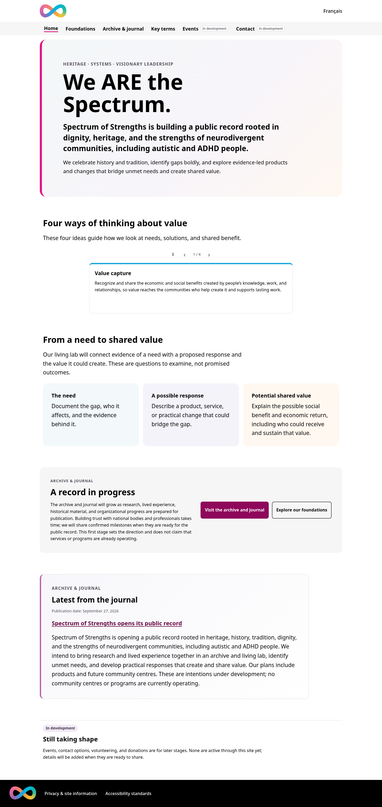

# Spectrum of Strengths

A bilingual public record for Spectrum of Strengths, built as a static React
site. It presents the organization's heritage and four value ideas in English
and French, with a dated archive for approved research and community records.
Events and contact options are clearly marked as in development.

**[Explore the live site](https://kommunarr.github.io/spectrum-of-strengths/)**

## Site preview

<a href="docs/screenshots/home-desktop.png"></a>
<a href="docs/screenshots/home-mobile-fr.png"></a>

## What the implementation demonstrates

- **Bilingual publishing:** paired English and French routes, language switching,
  translation validation, localized metadata, canonical URLs, and `hreflang`
  entries in page HTML and the sitemap.
- **Static delivery with readable initial HTML:** the production build generates
  direct route files, then hydrates them for client navigation and the carousel.
  Main content remains readable when JavaScript is disabled.
- **Accessible motion choices:** the value carousel can pause and resume, stops
  on focus and hover, and shows static cards when reduced motion is requested.
  Keyboard, reflow, and automated accessibility checks cover both languages.
- **A durable archive:** entries use bilingual permanent links and distinguish
  publication dates from dates of source material. Content checks require paired
  entry data and validate route and source fields.
- **Reviewable releases:** GitHub Actions runs code, build, browser, cross-browser,
  and Lighthouse checks. A separate scheduled job checks external links.

The [engineering case study](docs/engineering-case-study.md) explains the
requirements, implementation choices, evidence, and current limits. It is a
technical account of the site, not a claim that planned services are operating.
The [two-minute walkthrough](docs/demo-walkthrough.md) gives a short demo path,
and the [performance baseline](docs/performance-baseline.md) records the
current Lighthouse lab measurements and how to reproduce them.

## Project Documentation

- [Engineering guide](agents.md)
- [Ranked website role and archive work list](WORK-LIST.md)
- [Remaining work](docs/remaining-work.md)
- [Vision-aligned work catalog](docs/vision-roadmap.md)
- [First-stage content and publishing decisions](docs/first-stage-decisions.md)
- [Archive and journal entry workflow](docs/archive-entry-workflow.md)
- [Bilingual archive discoverability plan](docs/discoverability-plan.md)
- [Routine content update guide](docs/content-update-guide.md)
- [Opening release guide](docs/opening-release.md)
- [Content management research and migration plan](docs/content-management.md)
- [Testing strategy](docs/testing.md)

## Setup

```bash
npm ci
npm run setup:hooks
npm run dev
```

Before committing, run `npm run check`. The repository also installs local
pre-commit and pre-push hooks through `npm run prepare` when dependencies are
installed. GitHub Actions runs the same checks for pushes and pull requests.

To run the production browser suite locally, install Chromium with
`npx playwright install chromium`, then run `npm run test:browser`. See the
[testing strategy](docs/testing.md) for the covered user flows and the limits
of automated accessibility checks.

Run `npm run test:lighthouse` and `npm run test:lighthouse:mobile` with Chrome
installed to audit the production build in both profiles. They save HTML and
JSON reports under `lighthouse-reports/`, require an accessibility score of at
least 0.95 and a passing meta-description audit, and warn when performance,
best-practice, or SEO scores fall below their budgets. The Lighthouse runner
requires Node.js 22.19 or newer.

## Publishing and scope

The bilingual first release went live on 2026-09-27. The [opening release
guide](docs/opening-release.md) records the launch. `npm run deploy` publishes
approved updates to GitHub Pages and requires authorized repository access.
Keep the `/spectrum-of-strengths/` base path when changing routes or deployment.

CMS, newsletter, and contact-provider choices are deferred. See the
[remaining work](docs/remaining-work.md) and
[content management plan](docs/content-management.md) before connecting an
external service or publishing unapproved organization content.
